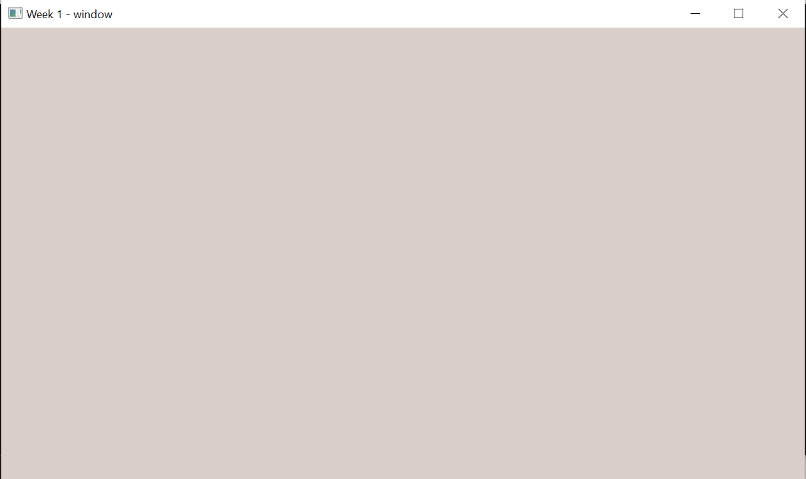
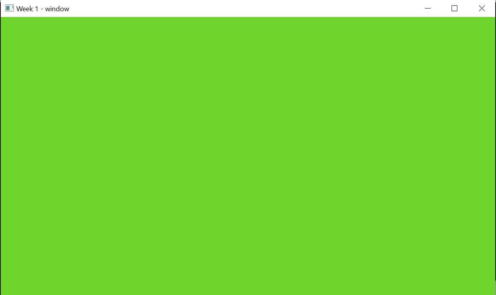
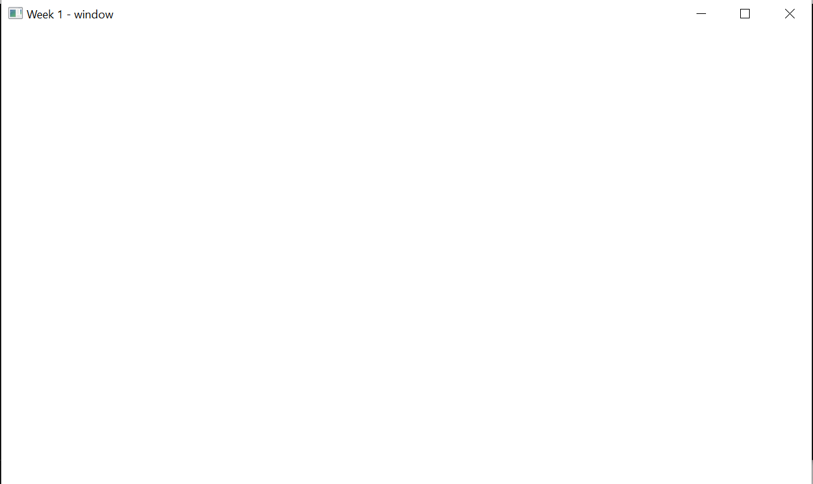

# Неделя 1 — окно и анимация фона

**Задание**
1. Окно 1280×720.
2. Цвет фона меняется со временем через `sin()`.
3. Ускорить смену цвета.
4. Пока зажат SPACE — фон белый.
5. Отпустили SPACE — анимация продолжается.
6. Выключить VSync: `glfwSwapInterval(0)`.
7. Раз в секунду выводить FPS в терминал.

**Как сделано** (`main.cpp`)
- каждый канал R, G, B — своя синусоида `0.5 + 0.5·sin(...)` с разной частотой и фазой;
- скорость анимации — константа `kColorSpeed = 2.5` (в 2.5 раза быстрее);
- SPACE проверяется каждый кадр через `glfwGetKey`: зажат → белый, иначе анимация;
- VSync выключен, кадры считаются и раз в секунду печатаются.

| Клавиша | Действие |
|---|---|
| SPACE (держать) | белый фон |
| ESC | выход |

**Результат** (AMD Radeon Graphics, OpenGL 3.3 Core)

| Анимация | Анимация, позже | SPACE зажат |
|---|---|---|
|  |  |  |

```
FPS: 2297
FPS: 2810
FPS: 2996
FPS: 2913
FPS: 2942
```

Без VSync около 2300–3000 FPS.
