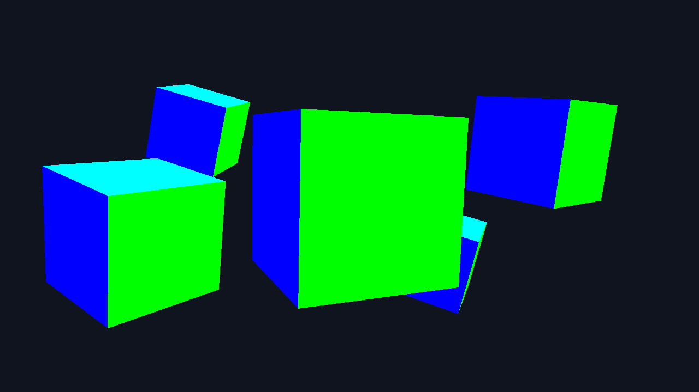
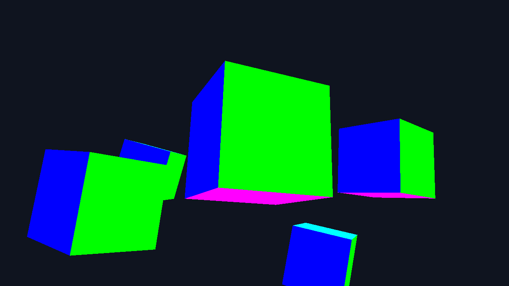
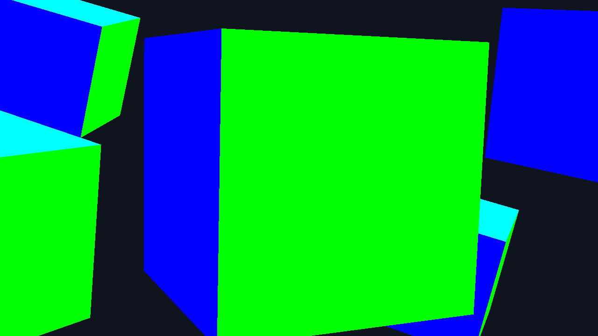

# 10-апта. Еркін камера

9-аптадағы бес кубты сахнада камераны тінтуірмен бұруға және дөңгелекпен көру бұрышын өзгертуге болады. Камера `(0, 0, 3)` нүктесінен `-Z` бағытына қарап бастайды. Бірінші тінтуір оқиғасы тек бастапқы координаттарды сақтайды.

## Құрастыру

Командаларды репозиторий түбірінде орындаңыз.

```bash
cmake -S . -B build
cmake --build build --config Debug --target week10
```

Linux-та `./build/bin/week10`, Windows-та MinGW үшін `build\bin\week10.exe`, Visual Studio үшін `build\bin\Debug\week10.exe` іске қосылады. GLFW және GLM алғашқы конфигурацияда жүктеледі.

## Басқару

| Басқару | Әрекет |
|---|---|
| Тінтуір | Камераны бұру |
| Дөңгелек | Алға айналдырғанда жақындатады, артқа айналдырғанда алыстатады. FOV `1°–90°` |
| W / S, A / D | Қараған бағытпен алға / артқа, камераға қатысты солға / оңға |
| Space / Left Shift | Әлемнің Y осімен жоғары / төмен |
| Left Ctrl | Екі есе жылдам жүру |
| I | Тік бағытты ауыстыру |
| P | Позиция, бағыт, yaw, pitch, FOV және бағыт векторының ұзындығын шығару |
| 1 / 2 / 3 | Сезімталдық `0.03 / 0.1 / 0.5` |
| R | Камераның позициясын, бағытын және FOV мәнін бастапқы күйге қайтару |
| Tab | Курсорды босату немесе қайта ұстау. Босатылғанда тінтуір камераны бұрмайды |
| Esc | Шығу |

Камера кубтардан бұрылып кеткенде тек фон көрінеді. `R` бастапқы көріністі қайтарады.

## Тәжірибе және қорғау

**1. Pitch шегі.** Шектеусіз `90°` мәнінде математикалық түрде `cos(90°) = 0`, сондықтан `camFront = (0, 1, 0)` және ол `camUp` векторына параллель. `cross(camFront, camUp)` нөлге тең. `glm::lookAt` осы нөл векторын нормалағанда матрицада NaN шығады. `float` тригонометриясы дәл 90° кезінде өте кіші нөлден өзге қалдық беруі мүмкін. Сол себепті тәжірибе кәдімгі есептеудің қалдығын бөлек шығарып, төртінші кадр үшін дәл полюсті `(0, 1, 0)` арқылы береді. Жарамсыз view болғанда тазартылған фон қалады. Қалыпты режимде pitch `−89°…+89°` шегінде.

**2. Сезімталдық.** Callback-ке 100 координата бірлігі берілгенде үш мән камераны тиісінше `3°`, `10°`, `50°` бұрады. Толық айналымға `12 000`, `3 600`, `720` бірлік керек. Тінтуірді көтеріп қою саны үстелдегі жүріс ұзындығы мен құрылғы баптауына байланысты. Әдепкі `0.1` таңдалды, себебі `0.03`-ке қарағанда бұрылуға аз қимыл керек, ал `0.5`-ке қарағанда ұсақ түзету оңай. Бұл нұсқада сезімталдық өзгермелі айнымалы, ал үш preset тұрақты мән ретінде берілген.

**3. Invert Y.** `I` тек басылған сәтте бір рет ауыстырады. Алдыңғы күйді сақтамаса, басып тұрған әр кадрда баптау кері айналып отырар еді. WASD-та кадр сайын `dt`-ға сай қозғалу керек, сондықтан перненің басулы күйі қолданылады.

**4. Камера күйі.** `P` бір басқанда бір рет шығарады. Синус, косинус және нормалау `float` арифметикасымен орындалатындықтан, ұзындық `1.0`-ге өте жақын болуы мүмкін. Формула идеал арифметикада бірлік вектор береді, `normalize` дөңгелектеу ауытқуын азайтады.

**5. FOV.** `90°` кезінде кадрға кеңірек кеңістік сыяды. Кадр шетіне жақын объектілердің созылыңқы көрінуі жазық экранға перспективалық проекциялаудан болады. Дөңгелек камераны жылжытпайды, проекцияның FOV мәнін өзгертеді.

Қосымша ретінде терезе тақырыбында yaw/pitch/FOV көрсетіледі, `R` камераны қалпына келтіреді және yaw `−180°…+180°` аралығында ұсталады.

## Төрт скриншот

| Бастапқы көрініс | Төменгі нүктеден жоғары қарау, pitch `22°` |
|---|---|
|  |  |
| **Зум, FOV `25°`** | **Дәл полюс, pitch `90°`** |
|  |  |

Кадрлар OpenGL framebuffer-інен алынды. `week10 --capture <қалта>` бірдей кадрларды PPM форматында шығарады және алғашқы тінтуір оқиғасын, pitch/FOV шектерін, Invert Y бағытын, вектор ұзындығын және үш сезімталдықты тексереді.
