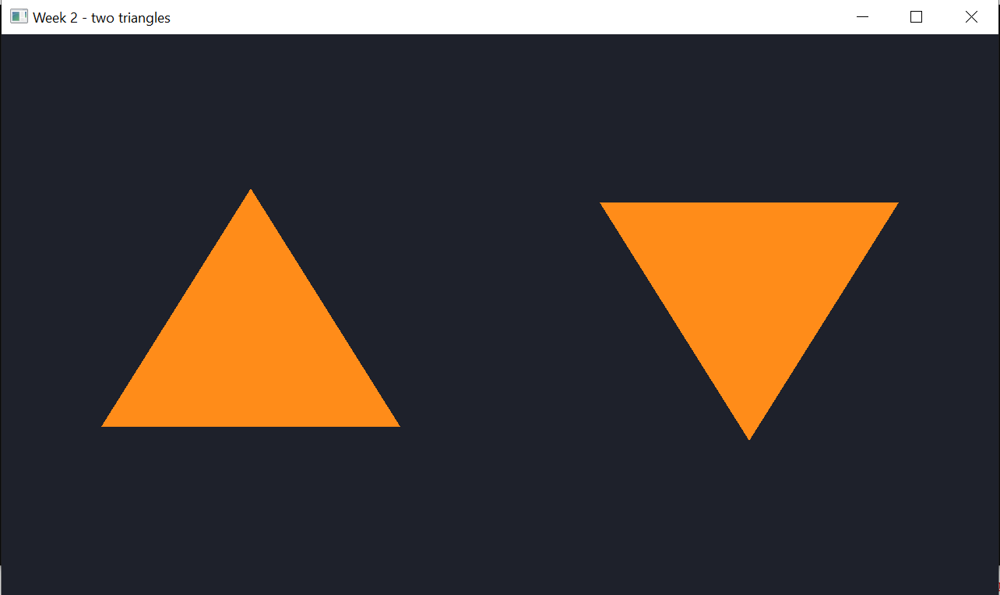
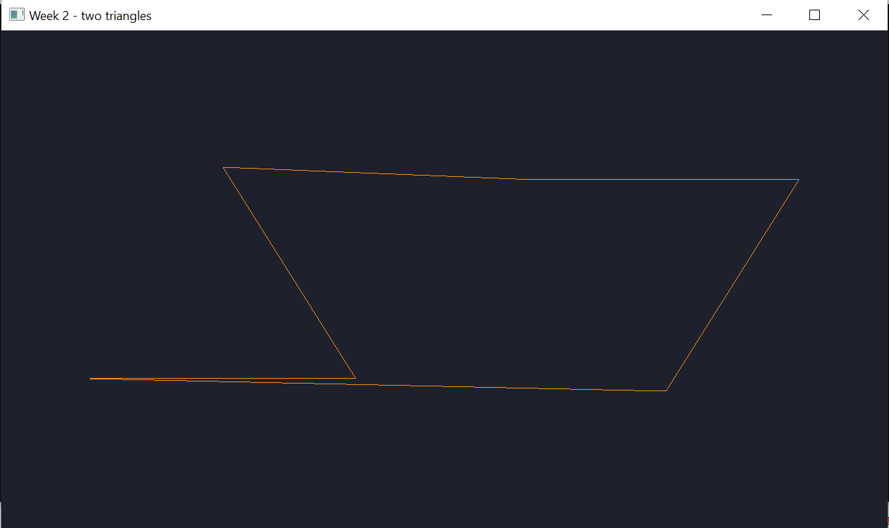
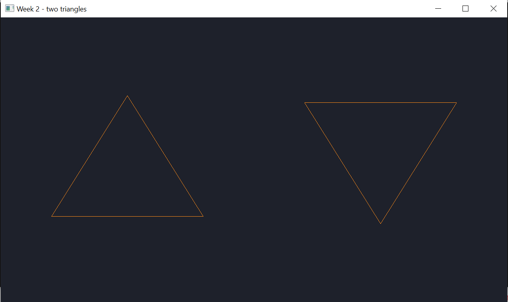
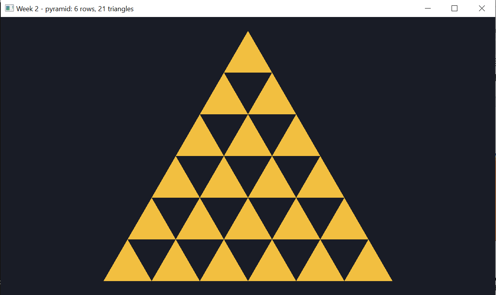
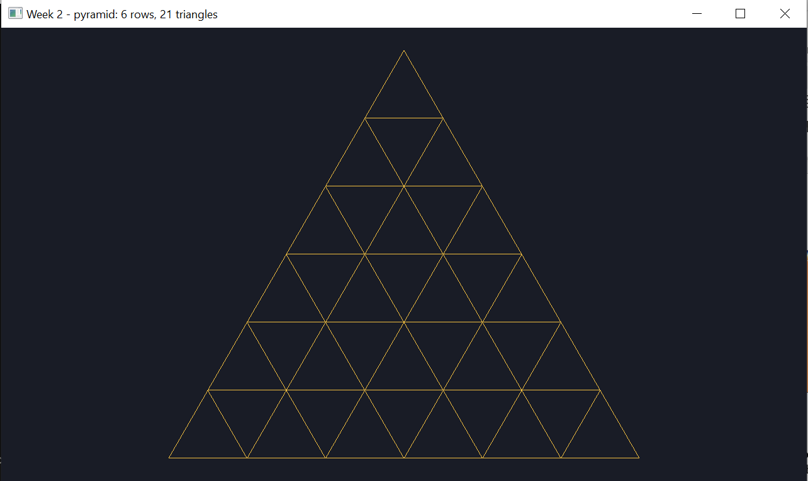

# Неделя 2 — VAO, VBO и треугольники

## Часть 1: два треугольника (`triangles.cpp`)

**Задание**
1. Нарисовать два отдельных треугольника из одного массива на 6 вершин.
2. Заменить `GL_TRIANGLES` на `GL_LINE_LOOP` и объяснить результат.
3. Каркасный режим через `glPolygonMode(GL_FRONT_AND_BACK, GL_LINE)`.
4. Поменять цвет во фрагментном шейдере (оранжевый).

**Как сделано**
- 6 вершин по 2 числа (x, y) в одном VBO, один вызов `glDrawArrays(..., 0, 6)`;
- цвет записан прямо во фрагментном шейдере: `vec4(1.0, 0.55, 0.1, 1.0)`.

**Почему так выглядит `GL_LINE_LOOP`:** он не делит вершины на тройки, а
соединяет все 6 по порядку линией и замыкает последнюю с первой. Получается
одна ломаная, и два треугольника выглядят как одна фигура.

В каркасном режиме примитив остаётся `GL_TRIANGLES`, но у каждого
треугольника рисуются только рёбра, поэтому треугольники остаются отдельными.

| Клавиша | Действие |
|---|---|
| L | `GL_TRIANGLES` ⇄ `GL_LINE_LOOP` |
| F | каркасный режим |
| ESC | выход |

| `GL_TRIANGLES` | `GL_LINE_LOOP` | каркасный режим |
|---|---|---|
|  |  |  |

## Часть 2: пирамида (`pyramid.cpp`)

**Задание.** Пользователь вводит число рядов N (1..100). Нарисовать пирамиду:
в верхнем ряду 1 треугольник, в следующем 2, …, в нижнем N.

**Как сделано**
- N берётся из аргумента (`week2_pyramid 6`) или вводится в консоли с проверкой;
- вершины строятся в цикле: ряд `r` содержит `r+1` равносторонних треугольников
  со стороной 1, ряд сдвинут влево на половину своей ширины;
- всего треугольников `N·(N+1)/2`, вершин в 3 раза больше;
- uniform `scale` переводит координаты в NDC так, что пирамида влезает в окно
  и треугольники не растягиваются при любом размере окна.

| Клавиша | Действие |
|---|---|
| TAB | каркасный режим |
| ESC | выход |

N = 6 → 21 треугольник:

| Заливка | Каркас |
|---|---|
|  |  |
