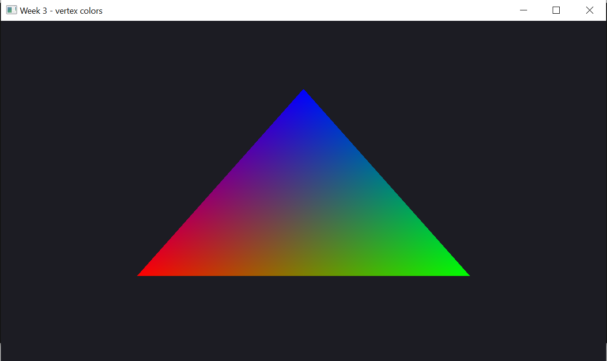
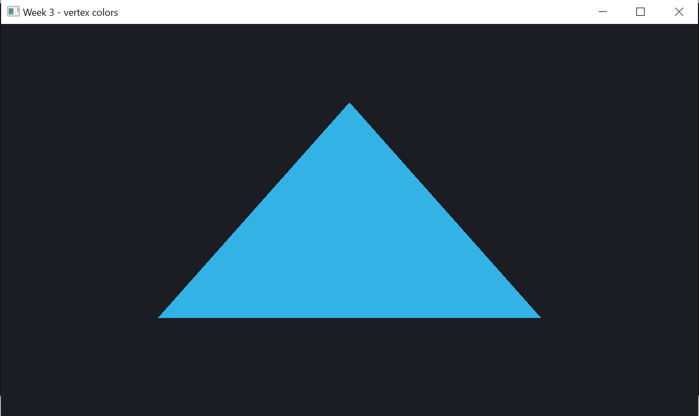
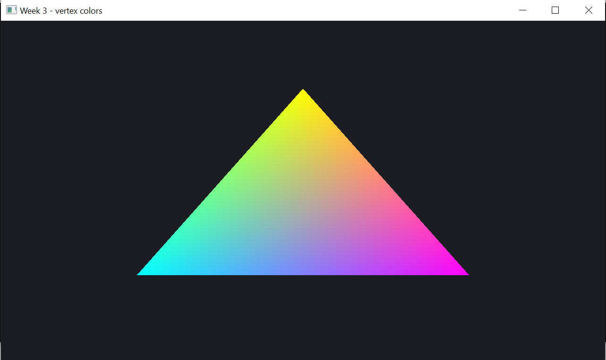
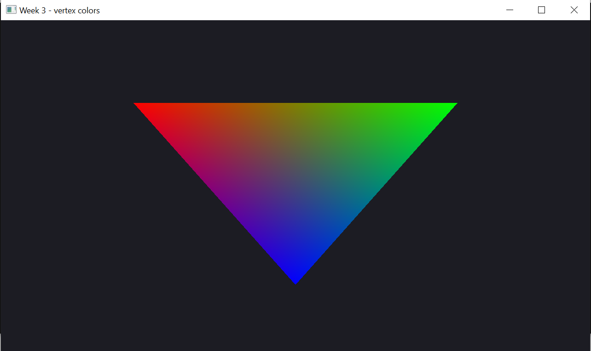

# Неделя 3 — цвет вершин и шейдеры

**Задание**
1. Дать трём вершинам разные цвета RGB — внутри треугольника появится градиент.
2. Дать всем трём вершинам одинаковый цвет — градиент пропадает.
3. Инвертировать цвет во фрагментном шейдере: `1.0 - цвет`.
4. Перевернуть треугольник в вершинном шейдере: `y * -1`.
5. Специально сделать ошибку в шейдере и посмотреть лог в консоли.

**Как сделано** (`main.cpp`)
- вершина = `{x, y, r, g, b}`, два атрибута (location 0 и 1) в одном VBO,
  смещение цвета внутри вершины — `offsetof(Vertex, r)`;
- цвет идёт из вершинного шейдера во фрагментный (`out` → `in`) и по пути
  интерполируется — это и есть градиент;
- C перезаписывает цвета в том же буфере через `glBufferSubData`;
- I и V — uniform-ы `invert` (bool) и `flipY` (1 или −1);
- E пробует собрать шейдер без `;` — `buildProgram` печатает лог и возвращает 0,
  а программа продолжает работать со старым, рабочим шейдером.

| Клавиша | Действие |
|---|---|
| C | RGB ⇄ один цвет |
| I | инверсия |
| V | перевернуть |
| E | шейдер с ошибкой → лог |
| ESC | выход |

| Градиент | Один цвет |
|---|---|
|  |  |
| **Инверсия** | **Перевёрнут** |
|  |  |

Лог после нажатия E:

```
[fragment shader] compile error:
Fragment shader failed to compile with the following errors:
ERROR: 0:8: error(#132) Syntax error: "outColor" parse error
ERROR: error(#273) 1 compilation errors.  No code generated
Build failed (see log above), the working shader is kept
```

`0:8` — строка 8. Точки с запятой нет в строке 7, но компилятор понимает это,
только когда видит следующее слово `outColor`.
