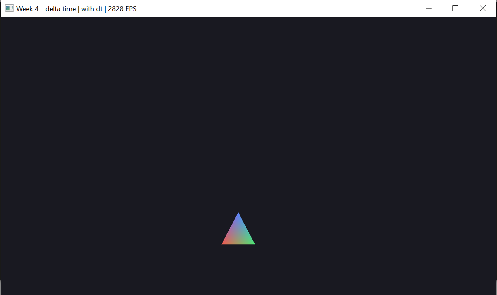
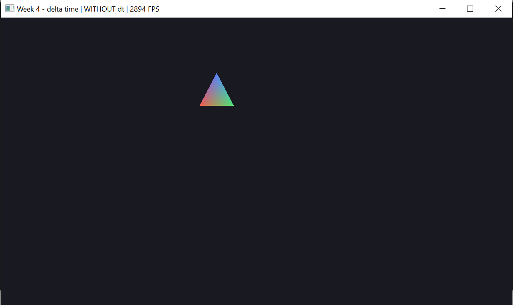

# Неделя 4 — движение и delta time

**Задание.** Треугольник движется по кругу: `angle += speed * dt`.
Убрать `dt` (написать `angle += 0.02`) и сравнить, потом вернуть `dt`.

**Как сделано** (`main.cpp`)
- каждый кадр: `dt = текущее время − время прошлого кадра`;
- позиция центра `(r·cos angle, r·sin angle)` передаётся в шейдер uniform-ом `center`;
- T переключает формулу: `angle += speed·dt` ⇄ `angle += 0.02` (за кадр);
- VSync по умолчанию выключен, V включает его — так видно, как скорость
  без `dt` зависит от FPS;
- `lastTime` при старте = текущее время (не 0), иначе первый `dt` был бы огромным;
- uniform `aspect` = высота/ширина — круг остаётся кругом в широком окне.

| Клавиша | Действие |
|---|---|
| T | с `dt` ⇄ без `dt` |
| V | VSync |
| ESC | выход |

**Результат.** В заголовке окна видно режим и FPS.

| С dt, ~2800 FPS | Без dt, ~2900 FPS |
|---|---|
|  |  |

Без `dt` угол растёт на 0.02 рад за кадр. При 2900 FPS это 58 рад/с
(около 9 оборотов в секунду), а с VSync при 165 FPS — 3.3 рад/с:
скорость зависит от компьютера. С `dt` при любом FPS скорость ровно 2 рад/с.
