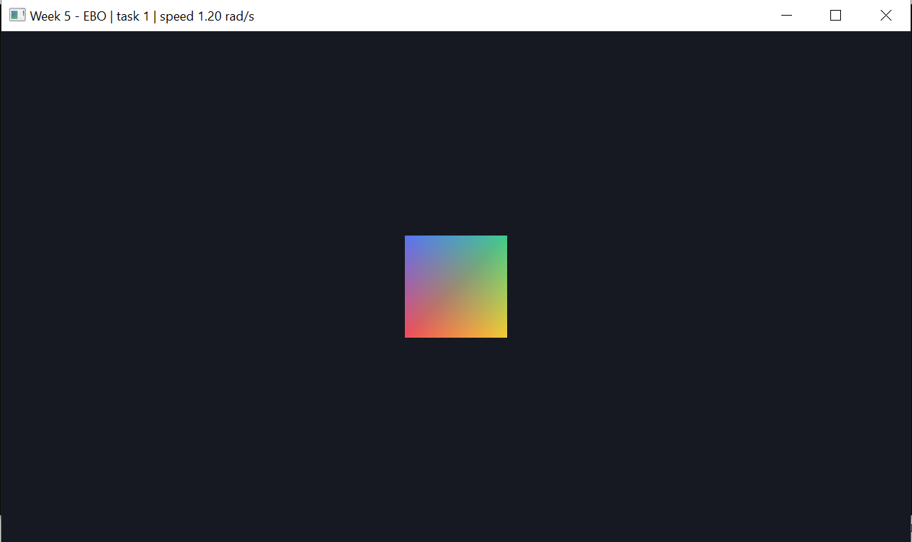
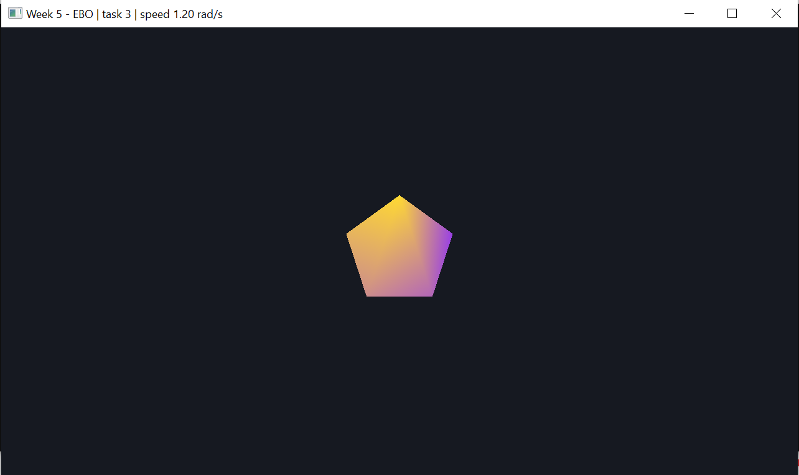
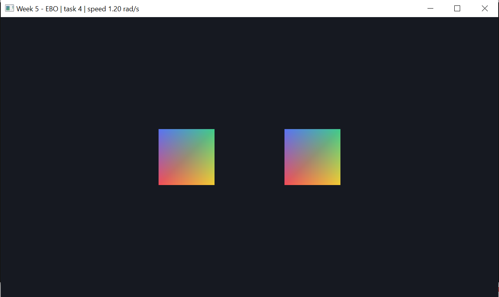
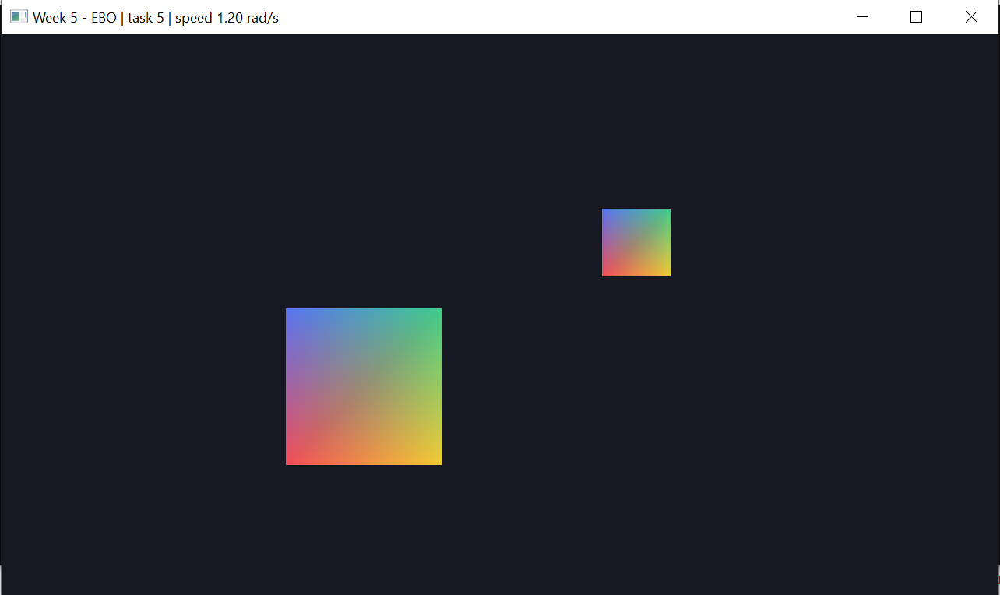
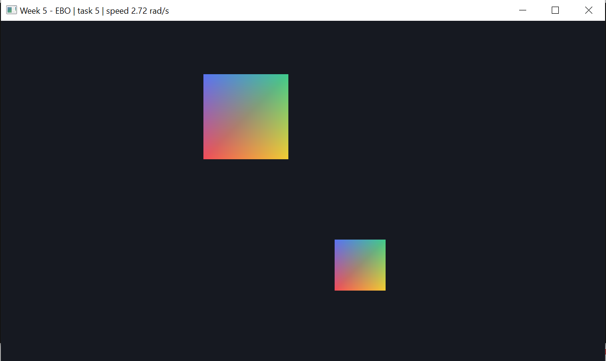

# Неделя 5 — EBO и glDrawElements

**Задание**
- Цветной четырёхугольник из 4 вершин и 6 индексов, `glDrawElements` вместо `glDrawArrays`.
1. Индексы `{0, 1, 2}` — вместо четырёхугольника один треугольник.
2. Цветной пятиугольник: 5 вершин, 9 индексов.
3. Два четырёхугольника из одного VAO/VBO/EBO, место задаётся `glUniform2f`.
- Движение с delta time, W/S меняют скорость.
- Итог: два четырёхугольника летают по кругу и меняют размер.

**Как сделано** (`main.cpp`)
- **все фигуры в одном VBO и одном EBO**: вершины 0–3 — квадрат, 4–8 — пятиугольник;
  индексы 0–5 — квадрат, 6–14 — пятиугольник;
- `glDrawElements(GL_TRIANGLES, count, GL_UNSIGNED_INT, смещение)`: фигура выбирается
  количеством индексов и смещением (в байтах) от начала EBO;
- индексы квадрата `{0,1,2, 2,3,0}`, поэтому задание 1 = нарисовать первые 3 индекса `{0,1,2}`;
- пятиугольник — вершины на окружности, треугольники «веером» из первой вершины:
  (0,1,2), (0,2,3), (0,3,4) → 9 индексов;
- uniform-ы: `center` (место), `size` (масштаб), `aspect` (пропорции окна);
- итог: квадраты в противоположных точках круга, размер `1 ± 0.4·sin(3t)`;
  скорость в рад/с, W/S меняют её на 1 рад/с за секунду.

| Клавиша | Действие |
|---|---|
| 1 | квадрат, 6 индексов |
| 2 | индексы {0,1,2} |
| 3 | пятиугольник, 9 индексов |
| 4 | два квадрата из одного VAO |
| 5 | итог: движение + размер |
| W / S (держать) | быстрее / медленнее |
| ESC | выход |

**Результат**

| 1 — квадрат | 2 — {0,1,2} | 3 — пятиугольник |
|---|---|---|
|  |  |  |
| **4 — два квадрата** | **5 — итог** | **5 — после W 1.5 с** |
|  |  |  |

После удержания W 1.5 с скорость выросла с 1.20 до 2.72 рад/с (видно в заголовке).
