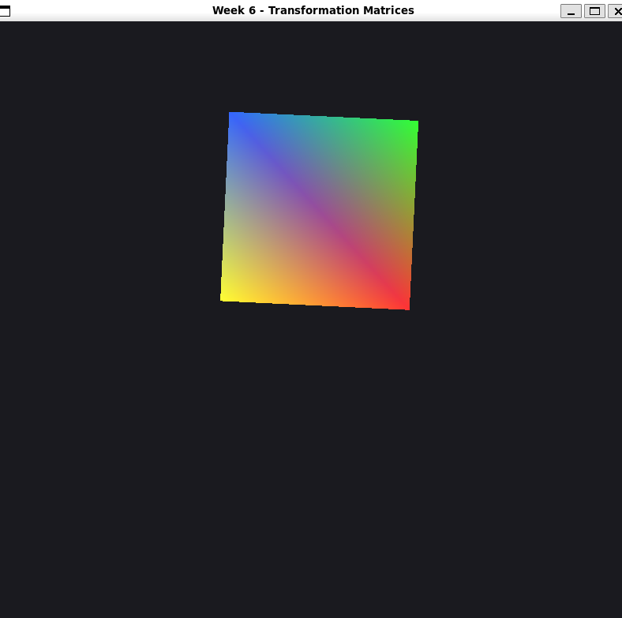
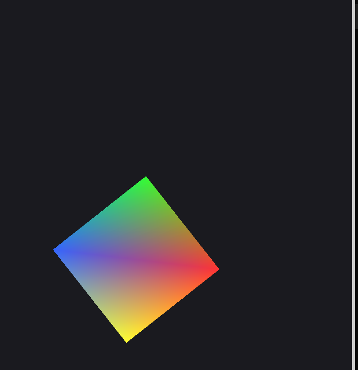
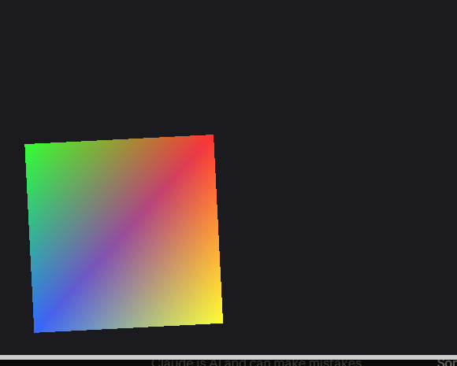
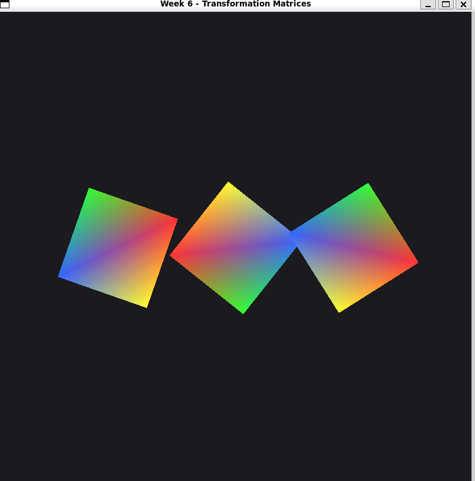

# Week 6 — Transformation Matrices (GLM)

## Жұмыстың мақсаты

Бұл зертханалық жұмыстың мақсаты — GLM кітапханасын қолданып, `mat4` түрлендіру матрицалары арқылы объектіні жылжыту, бұру және масштабтау, сондай-ақ түрлендіру ретінің нәтижеге әсерін зерттеу.

## 1. Жобаның сипаттамасы

C++, OpenGL және GLFW көмегімен түрлі-түсті төртбұрыш жасалды:

- Төртбұрыш шеңбер бойымен қозғалады.
- Төртбұрыш өз центрінен айналады.
- `uOffset` және `uScale` uniform-дары алынып, орнына бір ғана `mat4 uTransform` қолданылды.
- Матрица әр кадр сайын цикл ішінде қайта құрылады.

Бағдарламада төрт көрініс бар, олар пернемен ауысады: **1** — `T · R`, **2** — `R · T`, **3** — бұрыштан айналу, **4** — үш төртбұрыш. **Q / E** пернелері айналу жылдамдығын өзгертеді (`dt`-ге тәуелді), **Esc** — шығу.

Бағдарлама терезесінің өлшемі — 800×800 пиксель.

## 2. GLM кітапханасын қосу

`CMakeLists.txt` файлына `FetchContent` арқылы GLM қосылды:

```cmake
FetchContent_Declare(
    glm
    GIT_REPOSITORY https://github.com/g-truc/glm.git
    GIT_TAG 1.0.1
)
FetchContent_MakeAvailable(glm)

target_link_libraries(cg PRIVATE glfw glm::glm)
```

`main.cpp` басына үш include қосылды:

```cpp
#include <glm/glm.hpp>
#include <glm/gtc/matrix_transform.hpp>
#include <glm/gtc/type_ptr.hpp>
```

## 3. Vertex Shader

Екі uniform алынып, орнына біреу қойылды:

```glsl
#version 330 core
layout (location = 0) in vec3 aPos;
layout (location = 1) in vec3 aColor;

uniform mat4 uTransform;
out vec3 vColor;

void main()
{
    gl_Position = uTransform * vec4(aPos, 1.0);
    vColor = aColor;
}
```

Uniform орны циклге дейін бір рет кэштеледі:

```cpp
int locTransform = glGetUniformLocation(shader, "uTransform");
```

## 4. Матрицаны құру және сызу

```cpp
double now = glfwGetTime();
float dt = (float)(now - lastTime);
lastTime = now;
angle += speed * dt;

glm::mat4 m = glm::mat4(1.0f);
m = glm::translate(m, glm::vec3(std::cos(angle) * 0.4f,
                                std::sin(angle) * 0.4f, 0.0f));
m = glm::rotate(m, angle, glm::vec3(0.0f, 0.0f, 1.0f));
m = glm::scale(m, glm::vec3(0.6f, 0.6f, 1.0f));

glUseProgram(shader);
glUniformMatrix4fv(locTransform, 1, GL_FALSE, glm::value_ptr(m));
glBindVertexArray(vao);
glDrawElements(GL_TRIANGLES, 6, GL_UNSIGNED_INT, 0);
```

Маңызды:

- `glm::mat4 m` цикл ішінде жарияланады, әйтпесе түрлендірулер әр кадрда үстемеленіп, фигура жоғалып кетеді.
- Бұрыш радианмен беріледі, сондықтан `glm::radians` қажет емес.
- `glUniformMatrix4fv` үшінші параметрі `GL_FALSE`, себебі GLM матрицалары бағанмен сақталады және транспонирлеу керек емес.

## 5. Тапсырмалар

### 5.1 Түрлендіру ретін ауыстыру

`translate` мен `rotate` жолдарының орны ауыстырылды:

```cpp
m = glm::rotate(m, angle, glm::vec3(0.0f, 0.0f, 1.0f));
m = glm::translate(m, glm::vec3(std::cos(angle) * 0.4f,
                                std::sin(angle) * 0.4f, 0.0f));
```

- Бастапқы нұсқа: `translate → rotate`, яғни матрица **T · R**. Төбеге алдымен `R` әсер етеді (төртбұрыш өз центрінен бұрылады), содан кейін `T` оны шеңбердегі орнына жылжытады.
- Ауыстырылған нұсқа: **R · T**. Алдымен `T` әсер етеді (төртбұрыш орнына қойылады), содан кейін бүкіл нәтиже координат басынан айналады. Сондықтан орналасу нүктесі де бұрылады: центр сол радиуспен (0.4) шеңбер бойымен қозғалады, бірақ оның бұрышы `2·angle` болады, яғни төртбұрыш екі есе жылдам айналады.
- Мысал: координат басындағы нүктені алайық, `T` — (0, 4, 0)-ге жылжыту, `R` — 90° бұру.
  - `T · R`: алдымен `R` әсер етеді (нүкте басында қалады), сосын `T` → (0, 4, 0).
  - `R · T`: алдымен `T` әсер етеді → (0, 4, 0), сосын `R` оны координат басынан бұрады → (−4, 0, 0).
  - Нәтиже әртүрлі, яғни матрицалық көбейту ауыспалы емес: `T · R ≠ R · T`.

### 5.2 Бұрыштан айналу

Төртбұрыш сол төменгі бұрышынан айналады (сағат тіліне қарсы, себебі `glm::rotate`-те оң бұрыш +Z осіне қарағанда сағат тіліне қарсы бағытты білдіреді):

```cpp
m = glm::translate(m, glm::vec3(-0.3f, -0.3f, 0.0f));   // 3-ші әсер етеді: кері қайтару
m = glm::rotate(m, angle, glm::vec3(0.0f, 0.0f, 1.0f)); // 2-ші: бұру
m = glm::translate(m, glm::vec3( 0.3f,  0.3f, 0.0f));   // 1-ші әсер етеді: бұрышты басына апару
m = glm::scale(m, glm::vec3(0.6f, 0.6f, 1.0f));         // ең алдымен: өлшемді өзгерту
```

GLM-де соңғы жазылған жол бірінші әсер етеді. Бастапқы төртбұрыштың жартылай өлшемі 0.5, `scale(0.6)` оны 0.3 етеді, сондықтан сол төменгі бұрыш (−0.3, −0.3) нүктесінде тұрады. Төбеге алдымен `(0.3, 0.3)` әсер етіп, бұрышты координат басына әкеледі, сосын айналады, сосын `(−0.3, −0.3)` кері қайтарады. Сондықтан `-0.3` жолы кодта бірінші жазылғанымен, іс жүзінде ең соңында орындалады.

Екі `translate` жолының орны ауыстырылса, бұрыш координат басына емес, қарама-қарсы жаққа апарылады және төртбұрыш басқа нүктені айнала бастайды.

### 5.3 Үш объект, бір геометрия

Бір VAO, бірақ үш рет «матрица құру → `glUniformMatrix4fv` → `glDrawElements`»:

```cpp
glBindVertexArray(vao);
for (int i = 0; i < 3; i++) {
    glm::mat4 m = glm::mat4(1.0f);
    m = glm::translate(m, glm::vec3(-0.5f + i * 0.5f, 0.0f, 0.0f));
    m = glm::rotate(m, angle * (i + 1), glm::vec3(0.0f, 0.0f, 1.0f));
    m = glm::scale(m, glm::vec3(0.4f, 0.4f, 1.0f));
    glUniformMatrix4fv(locTransform, 1, GL_FALSE, glm::value_ptr(m));
    glDrawElements(GL_TRIANGLES, 6, GL_UNSIGNED_INT, 0);
}
```

Үш төртбұрыш әртүрлі жылдамдықпен айналады. `glm::mat4 m` цикл ішінде жарияланады: әр объектінің матрицасы бірлік матрицадан басталады. Сыртқа шығарса, түрлендірулер жиналып, объектілер жоғалады. Геометрия қайта жіберілмейді, тек матрица ауысады.

## 6. Бағдарлама нәтижелері

### 1-көрініс — Төртбұрыш шеңбер бойымен қозғалады (T · R)



### 2-көрініс — Түрлендіру реті ауыстырылған нұсқа (R · T)



### 3-көрініс — Төртбұрыш сол төменгі бұрышынан айналады



### 4-көрініс — Үш төртбұрыш әртүрлі жылдамдықпен айналады



## 7. Бағдарламаны іске қосу

```bash
cmake -S . -B build
cmake --build build -j
./build/bin/cg
```

## Қолданылған технологиялар

- C++
- OpenGL 3.3 Core Profile
- GLFW
- GLAD
- GLM 1.0.1
- GLSL Shader
- CMake
- Ubuntu WSL

## Қорытынды

Week 6 зертханалық жұмысында `uOffset` және `uScale` орнына бір `mat4 uTransform` қолданылды. `translate`, `rotate`, `scale` түрлендірулерінің реті нәтижеге тікелей әсер ететіні көрсетілді: GLM-де соңғы жазылған түрлендіру бірінші қолданылады. `R · T` реті центрді шеңбер бойымен екі есе жылдам қозғалтады. Бұрыштан айналу үшін «координат басына апару → бұру → кері қайтару» тәсілі, ал бірнеше объект үшін бір геометрияны әртүрлі матрицамен қайта сызу тәсілі қолданылды.
