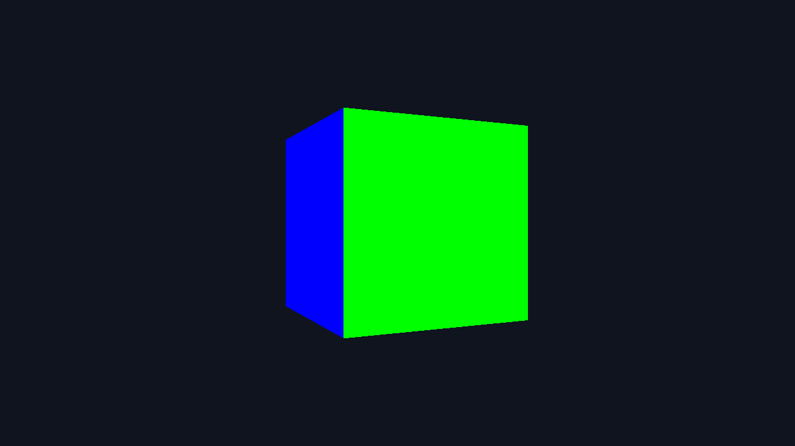
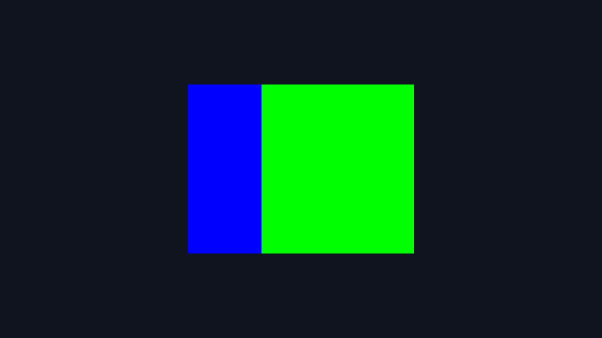
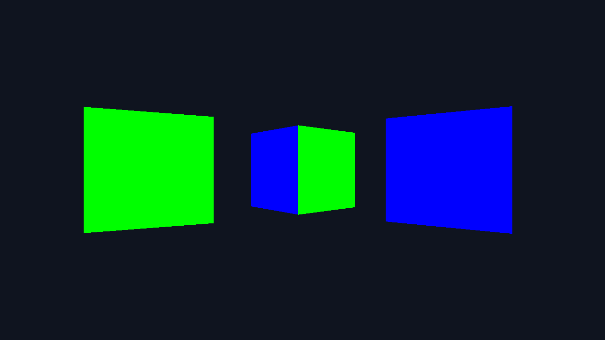
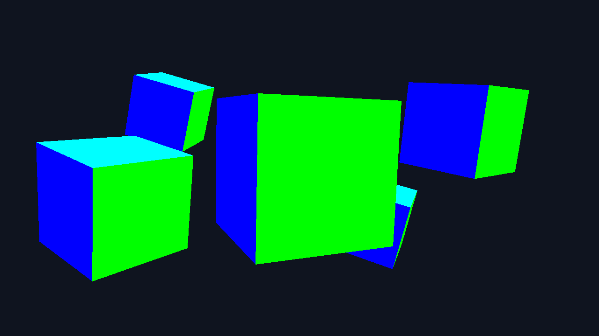
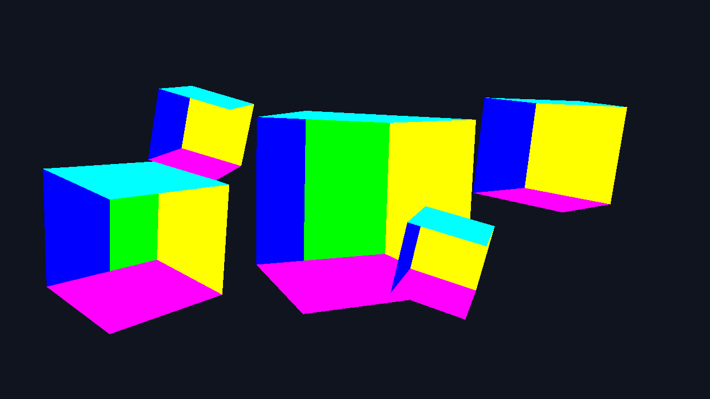
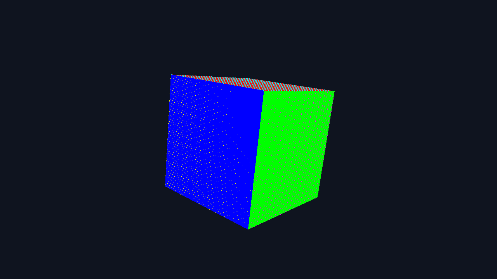
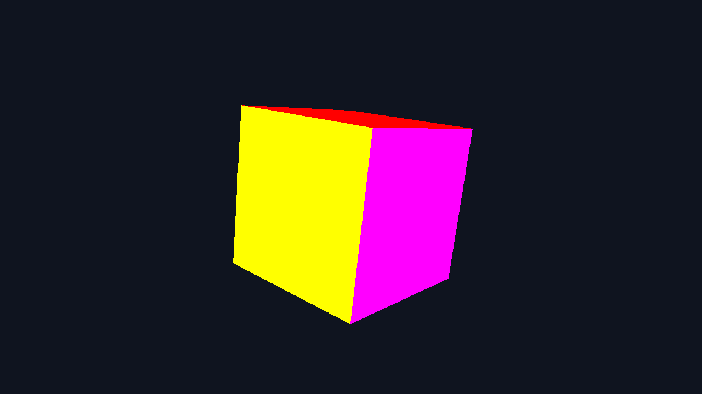
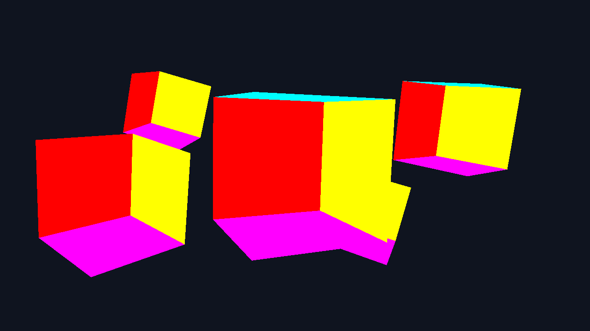
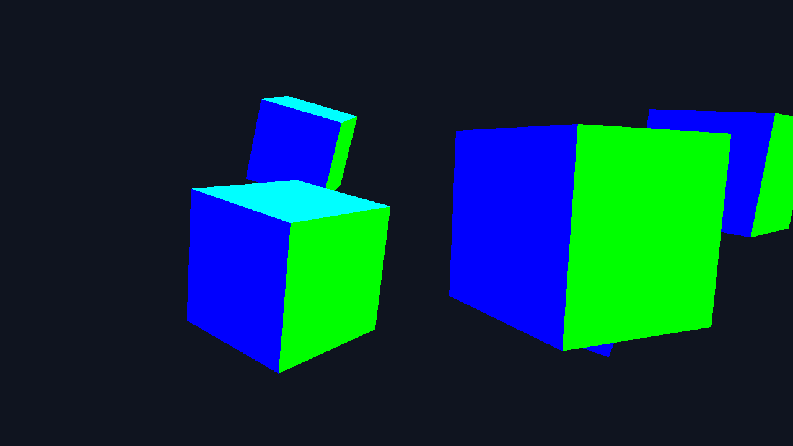

# 9-зертханалық жұмыс — 7–8 апталардың жалғасы

7-аптадағы MVP мен проекция, 8-аптадағы тереңдік буфері мен culling негізінде 9-аптаның LookAt камерасы жасалды. Барлық код `main.cpp` ішінде; ортақ GLFW/GLAD және shader көмекшілері бұрынғы `common/` қалтасынан қолданылады.

## Апталар қалай байланысады

| Апта | Осы жұмыстағы жүзеге асуы |
|---|---|
| 7: геометрия | 36 вершина × 6 float, әр қырға бөлек түс, `glDrawArrays(GL_TRIANGLES, 0, 36)` |
| 7: MVP | `uProjection * uView * uModel`, uniform орындары циклге дейін кэштеледі |
| 7: resize | `gWidth/gHeight` framebuffer callback ішінде жаңарады, aspect солардан есептеледі |
| 7: зерттеу | FOV/near/far параметрлері, перспектива/ортография, Y осімен айналатын бір және үш куб |
| 8: сахна | PDF-тегі бес позиция және `(0.3,1,0)` осімен әртүрлі жылдамдықта айналу |
| 8: көріну | Depth test, әр кадрда color/depth тазалау, `GL_BACK`, `GL_CCW` |
| 8: зерттеу | Depth on/off, сызу ретін өзгерту, culling, Z-fighting жасау/түзету |
| 9: камера | WASD, Space/Shift, Ctrl, dt, `lookAt(camPos, camPos + camFront, camUp)` |

Бес кубтың орталықтары: `(0,0,0)`, `(2,0.5,-2)`, `(-1.8,-0.3,-1)`, `(1.2,-0.8,-3.5)`, `(-2.2,1,-4)`. Камера олардың model матрицасын өзгертпейді. Орталықтары орнында қалады, кубтар 8-аптадағыдай өз осінен айналады.

## Құрастыру және іске қосу

Репозиторий түбірінен, CMake және C++17 компиляторымен:

```sh
cmake -S . -B build
cmake --build build --config Debug --target week9
```

Windows / Visual Studio: `build\bin\Debug\week9.exe`.
Windows / MinGW: `build\bin\week9.exe`.
Linux: `./build/bin/week9`.
GLFW және GLM бірінші конфигурацияда интернеттен жүктеледі; GLAD репозиторийде бар. Текстура немесе сыртқы сурет қажет емес.

## Басқару

| Перне | Әрекет |
|---|---|
| W / S | Алға / артқа |
| A / D | Камераның сол / оң жағына |
| Space / Left Shift | Әлемнің Y осімен жоғары / төмен |
| Left Ctrl | Басулы кезде жылдамдық 2.5-тен 5 бірлік/секундқа өседі |
| R / P | Камераны `(0,0,3)` орнына қайтару / координатты консольге шығару |
| 1 | Негізгі бес кубты сахна; параметрлер мен камераны қалпына келтіру |
| 2 | 7-апта: Y осімен айналатын бір куб; параметрлер мен камераны қалпына келтіру |
| 3 | 7-апта: үш куб, үш айналу жылдамдығы; камераны қалпына келтіру, үшеуі кадрға сыю үшін FOV=60° |
| 4 | Z координаттары 0.001-ге ерекшеленетін екі куб; параметрлерді қалпына келтіру |
| F | Айналуды тоқтату / жалғастыру (камера жұмыс істей береді) |
| O | Перспектива / ортография |
| F1 / F2 / F3 / F4 | FOV: 30° / 45° / 90° / 120° |
| F5 | Near: 0.1 → 1 → 2.5 → 4 → 0.1 |
| F6 | Far: 100 → 5 → 2 → 100 |
| B | Тереңдік тестін қосу / өшіру |
| C | Culling: BACK → FRONT → OFF → BACK |
| T | Объектілердің сызу ретін кері ауыстыру |
| Z | Екі қабаттасқан куб, near=0.0001, far=1000: Z-fighting |
| X | Near=0.1, far=100: тереңдік дәлдігін қалпына келтіру |
| Esc | Шығу |

Ауыстырғыштар бір басуға бір рет іске қосылады. Параметрлер терезе тақырыбында және консольде көрсетіледі. `near >= far` болса, жарамсыз проекция құрудың орнына сахна бос қалады; `1` немесе `X` арқылы қалпына келтіріңіз.

## 7-апта: проекция нәтижелері

Төмендегі параметрлер бір-бірінен тәуелсіз өзгертіледі: камера `(0,0,3)`, куб координат басында, бастапқы FOV=45°, near=0.1, far=100. Толық жоғалуды тексергенде айналуды тоқтатып, кубты бұрылмаған күйде қарастыру керек.

| Параметр | Нәтиже |
|---|---|
| FOV=30° | Қамтылатын бұрыш тар, куб үлкен көрінеді |
| FOV=45° | Қалыпты перспектива |
| FOV=90° | Қамтылатын бұрыш кеңейіп, куб кішірейеді |
| FOV=120° | Куб одан да кішкентай, кең бұрышты перспектива |
| near=0.1 | Куб көрінеді |
| near=1.0 | Куб көрінеді, оның барлық нүктесі near-дан әрі |
| near=2.5 | Алдыңғы беті дәл near жазықтығында. Осы GPU-дағы бұрылмаған куб толық жоғалды; айналдырғанда кей бөліктері көрінеді |
| near=4.0 | Куб толық қиылады: ең алыс нүктесі де 3.5-тен аспайды |
| far=100 | Куб көрінеді |
| far=5 | Куб көрінеді, себебі оның тереңдігі 2.5–3.5 аралығында |
| far=2 | Куб толық қиылады, себебі ол far-дан әрі |

Нақты алынған кадрларда үш бос нәтиже бар: **near=2.5, near=4 және far=2**. near=2.5 — шекаралық жағдай: алдыңғы бет дәл қиылу жазықтығында, қалған көрінетін геометрия бұрылу мен culling-ке байланысты. Сондықтан оны кез келген бұрышта міндетті түрде толық жоғалады деп айтуға болмайды. near=4 және far=2 кезінде куб Y осімен айналса да толық қиылады: жарты тереңдігі ең көбі шамамен 0.707 болғанда да оның аралығы 2.293–3.707 ішінде қалады.

Перспективада жақындағы бет үлкенірек көрінеді; ортографияда қашықтық өлшемге әсер етпейді, параллель қырлар параллель қалады. Ортографиялық матрицада `w=1`. FOV ортографияға әсер етпейді.

| Перспектива | Ортография |
|---|---|
|  |  |

Үш куб бір VAO-ны қолданады. Әрқайсысына жаңа model, ал view/projection үшеуіне ортақ. Ортадағы куб z=-1-де болғандықтан перспективада алысырақ әрі кішірек көрінеді. Айналу жылдамдықтары 0.5, 0.8 және 1.1 радиан/секунд.



Неге 8 емес, 36 вершина? Бір бұрыш үш қырға ортақ, ал әр қырдың түсі бөлек. 8 ортақ вершинамен қырлардың түсі араласып кетеді. 36 вершина әр үшбұрыштың position/color деректерін бөлек сақтайды.

## 8-апта: тереңдік, culling және Z-fighting

Негізгі режимде depth test циклге дейін қосылады. Әр кадрда `GL_COLOR_BUFFER_BIT | GL_DEPTH_BUFFER_BIT` тазаланады. Culling күйі `GL_BACK`, ал алдыңғы жақтың реті `GL_CCW`.

**Тереңдік тесті.** Бірдей кадрда, culling екі нұсқада да өшірулі:

| Depth ON | Depth OFF |
|---|---|
|  |  |

Тест өшірулі болса, соңынан салынған фрагмент алдыңғысын жабады. Қалыпты сызу реті 0→4 болғандықтан, қиылысқан экран аймақтарында кейін салынған куб басым болады. T арқылы кері ретке ауыстырғанда басымдық та өзгереді. Бір кубтың артқы жақтарының алда көрінуін анық көру үшін C арқылы culling-ті OFF етіңіз. Depth test қосулы болса, әдеттегі мөлдір емес, тереңдігі тең емес беттер үшін нәтиже сызу ретіне тәуелсіз.

**Z-fighting.** Z режимінде екі бірдей бұрылған кубтың әлемдік Z орындары 0 және 0.001. Екіншісінің түстері кері алынған, сондықтан қай беттің жеңгені байқалады. Near=0.0001, far=1000 кезінде тереңдік квантталуы екі жақын бетті ажырата алмайды. X арқылы near=0.1, far=100 орнатылады.

| Нашар дәлдік | Дәлдік қалпына келтірілген |
|---|---|
|  |  |

Өрнек GPU, depth buffer және камера орнына байланысты өзгереді; қозғалыста жыпылықтау байқалуы мүмкін. Негізгі түзету — near-ды көтеру. far-ды 1000-нан 100-ге азайту аздап көмектесуі мүмкін, бірақ өте кіші near туғызған дәлдік жоғалуын жалғыз өзі шешпейді. Перспективалық тереңдік біркелкі бөлінбейді: far near-дан әлдеқайда үлкен болса, буфер аралығының шамамен жартысы near мен 2×near арасында жұмсалады.

**Culling.** C арқылы BACK/FRONT/OFF салыстырылады. BACK кезінде сыртқы көрінетін беттер, FRONT кезінде кері беттер қалады. Бір бет тек режимді ауыстырғанда ғана дұрыс көрінсе, оның вершина ретін тексеру қажет. Жалпы бағыттан қарағанда кубтың 3 жағы (6 үшбұрыш) алдыңғы, 3 жағы (6 үшбұрыш) артқы болады; дәл ось бойымен қарағанда edge-on жақтар болуы мүмкін. Куб айналғанда жіктеуді GPU өзі есептейді, кодтағы индекстерді ауыстыру қажет емес.



## 9-апта: LookAt және камера


Үш айнымалы әлем координаттарында: `camPos=(0,0,3)`, `camFront=(0,0,-1)`, `camUp=(0,1,0)`. Әр кадрда:

```cpp
glm::lookAt(camPos, camPos + camFront, camUp);
```

**1. Екі LookAt нұсқасы.** `camPos + camFront` нысанасы камерамен бірге жылжиды, сондықтан A камераны бұрмай солға, бастапқы бағытта теріс X бойымен апарады. Екінші параметрді тұрақты `(0,0,0)` етсек, камера сол нүктеге қарау үшін A/D кезінде бұрылады. Мұндай нысаналы камера модельді қарауға пайдалы. Бұл кодтағы орын ауыстыру түзу сызықты, қашықтығы тұрақты шеңберлік орбита емес. Соңғы кодта еркін қозғалыстың дұрыс нұсқасы қалдырылды.

**2. Жоғары-төмен.** Әлемнің Y осі таңдалды: адамның көтерілуі/түсуіне ыңғайлы. Ұшақтың жергілікті бағыты үшін камераның өз Up осі керек болар еді. Осы аптада екі ось бірдей.

**3. Ctrl және dt.** Қадам `2.5 * dt`, Ctrl кезінде екі есе. Көбейту ретін ауыстыру математикалық нәтижені өзгертпейді: `(2.5 * dt) * 2 = (2.5 * 2) * dt`. Жылжымалы нүктеде аз дөңгелектеу айырмасы болуы мүмкін. A/D бағыты `normalize(cross(camFront, camUp))`, сондықтан бүйірлік вектор бірлік ұзындықта. Бірнеше бағытты бірге басқанда қадамдар бастапқы тапсырмадағыдай қосылады; диагональ жылдамдығы жоғарырақ.

LookAt базисі: `Direction=normalize(eye-center)`, `Right=normalize(cross(worldUp,Direction))`, `Up=cross(Direction,Right)`. View — камера орналасуының кері матрицасы; ортонормаль бұру үшін кері матрица транспонирленген матрицаға тең.



## Қорғауда көрсету реті

1. Негізгі бес кубты сахнада WASD, Space/Shift, Ctrl, P және R көрсету.
2. 2 режимінде Y айналуын, O арқылы ортографияны, F1–F6 арқылы параметрлерді көрсету.
3. 3 режимінде үш объектіге үш model және ортақ view/projection барын түсіндіру.
4. 1 режимінде F арқылы айналуды тоқтату, C арқылы OFF таңдап, B көмегімен depth on/off салыстыру; T арқылы сызу ретін ауыстыру.
5. 1 басып күйді қалпына келтіру; C арқылы FRONT/BACK айырмасын көрсету.
6. Z арқылы Z-fighting, X арқылы түзету; 1 арқылы негізгі режимге оралу.

## Көріністерді қайта шығару

Бағдарлама нақты OpenGL framebuffer-ден PPM суреттерін шығара алады:

```sh
build\bin\week9.exe --capture build\week9-captures
```

Суреттер бірдей бекітілген бұрыштарда түсіріледі. README ішіндегі PNG файлдары осы framebuffer суреттерінен формат ауыстыру арқылы алынған. `screenshots/` түбіріндегі camera1–3 суреттері бұрынғы нұсқаға жатады; жаңартылған нұсқаның суреттері `screenshots/integrated/` ішінде.

Тексеру ортасы: Intel UHD Graphics, OpenGL 3.3, 24-биттік depth buffer. 22 кадр OpenGL қатесінсіз шығарылды. Қозғалыстың 30/144 FPS кезіндегі теңдігі, Ctrl, алты бағыт, бүйірлік вектордың нормалануы, LookAt бағыты, CCW және қыр түстері бойынша 10 тексеру бар:

```sh
cmake -S . -B build -DWEEK9_BUILD_CHECKS=ON
cmake --build build --config Debug --target week9_checks
```

Содан кейін MinGW-де `build\bin\week9_checks.exe`, Visual Studio-да `build\bin\Debug\week9_checks.exe` іске қосылады. Бұл тексерулер қозғалыс логикасын тексереді; физикалық пернетақтаны эмуляцияламайды.

Бұрынғы `week09` тегі алғашқы нұсқаны сақтайды. 7–8 апталармен біріктірілген түзету `main` тармағында және `week09-v2` тегінде беріледі. Бұл 9-зертханалықтың біртұтас нұсқасы; бөлек 7/8 зертханалық тапсырылымдары жасалмайды.
